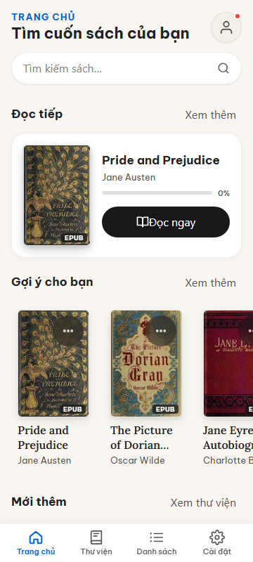
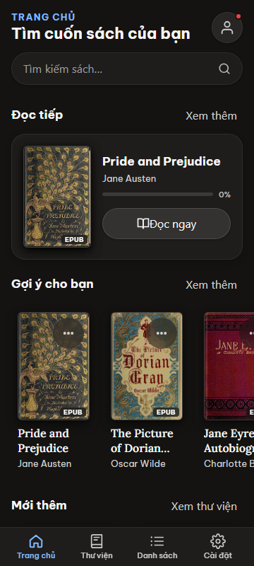
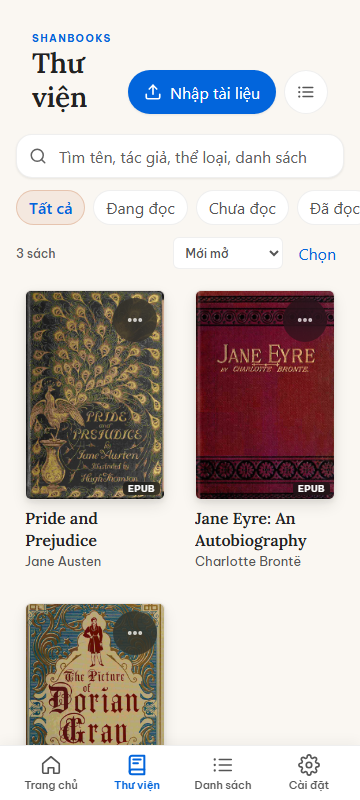
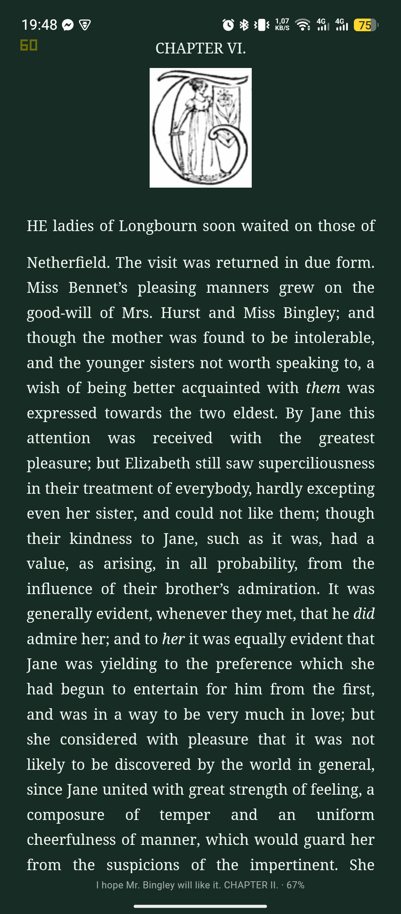
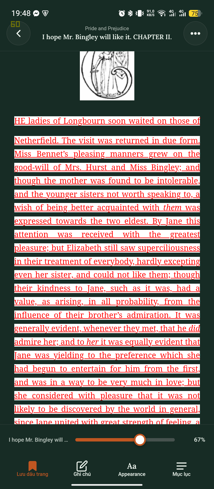
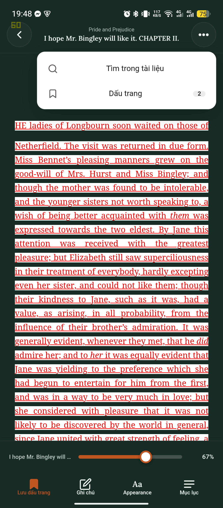

# Hanbooks (ShanBooks)

<p align="center">
  <strong>An offline, multi-format personal reader designed for typography, focus, and reading immersion.</strong>
</p>

<p align="center">
  
  
  
  
  
  
</p>

---

## 📱 Giao diện mới nhất / Showcase

### 1. Trang chủ (Home) & Kệ sách (Editorial Design)
Giao diện biên tập tối giản với thẻ đọc tiếp (*Continue Reading*), tiến độ trực quan, tìm kiếm nhanh và kệ sách cá nhân (*Shelves*).

| Giao diện Sáng (Light Mode) | Giao diện Tối (Dark Mode) |
| :---: | :---: |
|  |  |

---

### 2. Thư viện cá nhân (Personal Library) & Trình đọc chuyên sâu (Reader)
Thư viện hiển thị dạng lưới hoặc danh sách, hỗ trợ chọn nhiều sách, đổi ảnh bìa, gắn nhãn định dạng. Màn hình đọc được tối ưu viền an toàn (*Safe-area insets*), tiêu đề chương chạy ngầm và thanh điều khiển mượt mà.

| Thư viện dạng lưới | Trọng tâm đọc sách (Reading Surface) |
| :---: | :---: |
|  |  |

---

### 3. Điều khiển thông minh (Reader Controls) & Tùy biến trang đọc (Settings)
Thanh công cụ đối xứng, thanh kéo tiến độ độ tương phản cao (> 3:1), đánh dấu trang với hoàn tác (*Undo*), cùng bảng cài đặt màu nền (Default, Paper, Dark, Sepia, Cream, Forest, Midnight), phông chữ, cỡ chữ, khoảng cách dòng và lề.

| Thanh điều khiển đọc sách | Bảng tùy biến hiển thị & phông chữ |
| :---: | :---: |
|  |  |

---

## ✨ Điểm nổi bật / Key Features

- **Hỗ trợ đa định dạng tài liệu**: Đọc ngoại tuyến hoàn toàn các tệp `.epub`, `.pdf`, `.docx`, `.pptx`, `.cbz`, `.txt`, `.md`, `.html`.
- **Hỗ trợ tệp nén ZIP & RAR**: Tự động giải nén trong Web Worker ngầm, nhận diện và phân loại toàn bộ sách trong tệp nén vào kệ sách tương ứng.
- **Trải nghiệm đọc xuất bản (Editorial Reader)**:
  - Hệ màu phong phú bảo vệ mắt: *Default, Paper, Warm Cream, Sepia, Forest, Midnight, Dark*.
  - Tùy biến phông chữ, cỡ chữ (pt), khoảng cách dòng (line height), lề trang (margin).
  - Hai chế độ hiển thị: Phân trang (*Paginated*) hoặc Cuộn mượt (*Scroll*).
  - Nhận diện và làm sạch thông minh tiêu đề mục lục (TOC cleaning), loại bỏ chú thích trùng lặp.
  - Tìm kiếm toàn văn bản trong sách kèm đánh dấu từ khóa (*Highlight snippet*).
  - Đánh dấu trang (*Bookmarks*) và lưu lịch sử vị trí đọc đến từng phân đoạn (*Locator/CFI*).
- **Offline-First & Bảo toàn dữ liệu**:
  - Dữ liệu sách, bìa, vị trí và tiến độ lưu trữ an toàn trong IndexedDB (`aurelia_db`) và LocalStorage.
  - Xuất sao lưu toàn bộ thư viện ra tệp `.zip` hoặc sao lưu dữ liệu `.json`.
  - Khôi phục và hợp nhất dữ liệu ngoại tuyến không mất mát.
- **Tối ưu Android Native**:
  - Đóng gói bằng Capacitor 8 cho Android (`com.aurelia.books`).
  - Hỗ trợ phím quay lại hệ thống (*Native Back button*), cử chỉ vuốt, đổi theme hệ thống (*System Dark/Light mode*).
  - Kiểm tra rào cản Safe-Area: Tuyệt đối không để chữ lọt dưới tai thỏ, thanh trạng thái hay thanh điều hướng cử chỉ.
  - Đạt chuẩn tiếp cận A11y (WCAG AA, tương phản màu > 4.5:1, nhãn Accessible đầy đủ).

---

## 🛠️ Công nghệ / Tech Stack

| Thành phần | Công nghệ sử dụng |
| :--- | :--- |
| **Giao diện & Logic** | React 19, JavaScript (ESM) |
| **Hệ thống thiết kế** | Adobe Spectrum S2 (`@react-spectrum/s2`), CSS Modules, CSS Tokens |
| **Đóng gói ứng dụng** | Vite 8, LightningCSS |
| **Nền tảng di động** | Capacitor 8 (Android SDK 34 / 35, JDK 21) |
| **Đọc định dạng** | `epubjs`, `pdfjs-dist`, `mammoth`, `@web-ppt/core`, `marked` |
| **Xử lý tệp nén** | `fflate` (ZIP), `node-unrar-js` (RAR/WASM) trong Web Worker |
| **Lưu trữ ngoại tuyến** | IndexedDB (`aurelia_db`) |
| **Kiểm thử tự động** | Vitest (Unit tests), Playwright (E2E & Accessibility tests), Axe-core |

---

## 🚀 Hướng dẫn cài đặt & Chạy ứng dụng

### 1. Yêu cầu môi trường
- **Node.js**: v20+ hoặc v22+
- **JDK**: Java Development Kit 21 (dành cho đóng gói Android)
- **Android SDK**: Android Studio Jellyfish hoặc mới hơn (SDK Platform 34/35)

### 2. Cài đặt dependencies

```powershell
cd aurelia-books
npm install
```

### 3. Chạy môi trường phát triển (Dev Server)

```powershell
npm run dev
```

Truy cập trên trình duyệt tại `http://localhost:5173`.

### 4. Kiểm tra chất lượng mã nguồn (Quality Checks)

```powershell
# Kiểm tra linting (ESLint 9+)
npm run lint

# Kiểm tra chuẩn Adobe Spectrum & Button Wrappers
npm run test:elements

# Kiểm tra chuỗi đa ngôn ngữ (i18n)
npm run test:i18n

# Chạy toàn bộ 93 unit tests
npm run test:unit

# Build bundle sản phẩm
npm run build
```

### 5. Đóng gói Android APK

```powershell
# Đồng bộ web assets vào dự án Android
npm run android:sync

# Biên dịch Debug APK qua Gradle
npm run android:apk
```

Tệp APK hoàn chỉnh được sinh tại:
```text
aurelia-books/android/app/build/outputs/apk/debug/app-debug.apk
```

---

## 📂 Cấu trúc thư mục (Repository Layout)

```text
.
|-- aurelia-books/                  # Thư mục chính của ứng dụng
|   |-- android/                    # Mã nguồn nền tảng Android (Capacitor)
|   |-- src/                        # Mã nguồn giao diện & logic (React 19)
|   |   |-- components/             # Components (Home, Library, Lists, Reader, Settings, Common)
|   |   |-- hooks/                  # Custom hooks (useLibrary, useReader, useSettings)
|   |   |-- readers/                # Adapters đọc tài liệu (EPUB, PDF, DOCX, PPTX, CBZ, TXT, MD)
|   |   |-- styles/                 # Hệ thống CSS Tokens & Biến màu chủ đề
|   |   `-- utils/                  # Xử lý IndexedDB, metadata, nén tệp, di chuyển dữ liệu
|   |-- scripts/                    # Kịch bản kiểm tra chất lượng & sinh fixtures
|   `-- tests/                      # Bộ kiểm thử Unit (Vitest) & E2E (Playwright)
|-- assets/                         # Tài nguyên giới thiệu & ảnh chụp màn hình
|   `-- screenshots/                # Bộ ảnh chụp giao diện mới nhất
`-- README.md                       # Tài liệu tổng quan dự án
```

---

## 🔒 Quy định dọn dẹp (Cleanup Policy)

Kho lưu trữ được cấu hình tự động loại trừ mọi tệp rác và báo cáo tạm thời khi phát triển:
- Không commit `node_modules/`, `dist/`, thư mục build Gradle của Android.
- Báo cáo và ảnh chụp Playwright được lưu vào `.artifacts/` (đã gitignore).
- Tài liệu nội bộ máy phát triển (`docs/`) được lưu giữ cục bộ, không đẩy lên remote.
- Giữ nguyên lịch sử commit nguyên bản, an toàn tuyệt đối cho repository.
